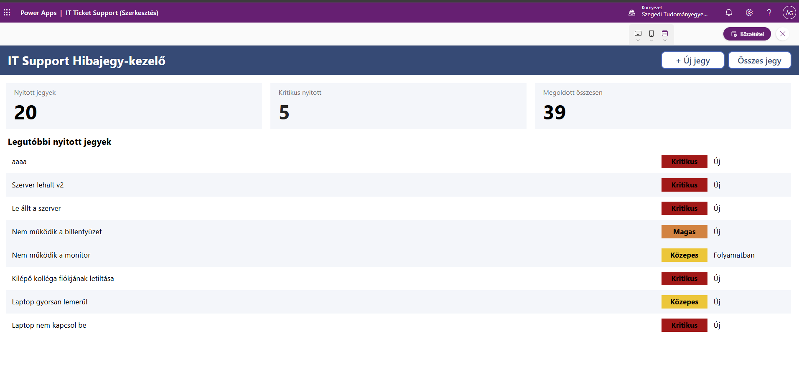

# IT Support Hibajegy-kezelő – Projektdokumentáció

Készítette: Ádám Adrián 

## 1. Cél és felhasználók
A projekt egy egyszerű, ServiceNow-szerű hibajegy-kezelő megoldás, amely a Microsoft Power Platform három eszközét köti össze: a Power Apps felületet, a Power Automate értesítéseket és a Power BI riportot. Adattárként egy SharePoint listát alkalmaztam.

**Felhasználói szerepkörök:**

| Szerepkör | Mit tehet |
| --- | --- |
| Ügyintéző, Bejelentő | Minden jegyet lát, felelőst vállal, státuszt módosít, megoldási megjegyzést ír |
| Riportolvasó | A Power BI riportban követi a jegyek alakulását |
## 2. Architektúra

| Komponens | Szerep |
| --- | --- |
| SharePoint lista (`Hibajegyek`) | Adattár, az IT Support Demo Team site-on |
| Power Apps canvas app | Jegyek felvétele, listázása, szerkesztése |
| Power Automate (2 flow) | E-mail értesítés új és megoldott jegyről |
| Power BI Desktop riport | Elemzés és vizualizáció a SharePoint listából |

Az adatok a SharePoint listában vannak. Az app és a flow-k közvetlenül ezt a listát olvassák és írják, a Power BI csak vizualizációra alkalmas.

## 3. Adatmodell

A lista neve Hibajegyek.

| Megjelenített név | Belső név | Típus | Megjegyzés |
| --- | --- | --- | --- |
| Jegy címe | `Title` | Szöveg | Kötelező |
| Leírás | `Leiras` | Több soros szöveg |  |
| Kategória | `Kategoria` | Választó | Hardver, Szoftver, Hálózat, Jogosultság, Egyéb. Kötelező |
| Prioritás | `Prioritas` | Választó | Alacsony, Közepes, Magas, Kritikus. Kötelező, alapérték: Közepes |
| Státusz | `Statusz` | Választó | Új, Folyamatban, Megoldva, Lezárva. Kötelező, alapérték: Új |
| Bejelentő | `Bejelento` | Személy | Az app tölti ki a bejelentkezett felhasználóval |
| Felelős | `Felelos` | Személy | A „Magamra veszem” gomb tölti ki |
| Létrehozva | `Letrehozva` | Dátum és idő | Külön oszlop a beépített `Created` helyett, hogy a tesztadat visszadátumozható legyen |
| Lezárva | `Lezarva` | Dátum és idő | Megoldáskor automatikusan kitöltődik |
| Megoldási megjegyzés | `MegoldasiMegj` | Több soros szöveg | Megoldott jegynél kötelező|

**Nézetek:** `Nyitott jegyek` (a Lezárva státuszú jegyek nélkül) és `Saját jegyeim` (Bejelentő = \[Me\]).

**Definíciók:** a *nyitott* jegy státusza Új vagy Folyamatban.

## 4. Power Apps alkalmazás

| Képernyő | Tartalom |
| --- | --- |
| `scrDashboard` | Három számláló (nyitott, kritikus nyitott, megoldott), a legutóbbi nyitott jegyek galériája prioritás szerinti színezéssel, navigációs gombok |
| `scrLista` | Keresőmező, szűrők (státusz, prioritás, kategória), a jegyek galériája helyes prioritás szerinti rendezéssel, üres állapot kezelése |
| `scrUjJegy` | Új jegy űrlap kötelező mezőkkel, validációval és hibakezeléssel |
| `scrReszlet` | A jegy adatai, és ügyintézőknek szerkesztő rész: státuszváltás, megoldási megjegyzés, „Magamra veszem” gomb |

**Fontosabb megoldások:**

- **Szerepkörös nézet:** a `varIsAgent` változó az e-mail cím alapján dönt. Az ügyintéző minden jegyet lát és szerkeszthet, a többi felhasználó csak a saját jegyeit látja, szerkesztő elemek nélkül.
- **Prioritás szerinti rendezés:** a `Switch` függvény számra képezi le a prioritást (Kritikus, Magas, Közepes, Alacsony), így nem ábécé szerint rendez.
- **Validáció:** üres cím vagy kategória esetén hibaüzenet jelenik meg. Megoldott vagy lezárt jegynél a megoldási megjegyzés kötelező.
- **Hibakezelés:** a mentések `IfError` függvénnyel futnak, a hiba szövege a felhasználónak is megjelenik.
- **Lezárva dátum:** az app tölti ki, amikor a státusz Megoldva vagy Lezárva lesz, újranyitáskor törli. Ebből számolja a Power BI a megoldási időt.
- **Egységes színvilág:** a színek globális változókban vannak (`cPrimary`, `cKritikus`, `cMagas`, `cKozepes`, `cAlacsony`), és megegyeznek a Power BI riport színeivel.

## 5. Power Automate folyamatok

**1. Új hibajegy értesítés**

- Trigger: SharePoint, Amikor egy elem létre lett hozva.
- Feltétel: a Prioritás értéke Kritikus-e.
- Igaz ág: kiemelt (magas fontosságú) e-mailt küld, a tárgyában a KRITIKUS jelöléssel.
- Hamis ág: sima értesítő e-mailt küld.
- Az új jegynek még nincs felelőse, ezért az értesítés egy fix címre megy (egy IT-csapat közös postafiókját imitálva).

**2. Megoldott jegy értesítés**

- Trigger: SharePoint, Amikor egy elem létre lett hozva vagy módosítva lett.
- Trigger feltétel: a flow csak akkor indul, ha a Státusz értéke Megoldva. Ez megakadályozza, hogy minden módosításnál lefusson.
- Feltétel: a bejelentő e-mail címe nem üres.
- Igaz ág: e-mailt küld a bejelentőnek a jegy azonosítójával, a jegy többi adatával és a megoldási megjegyzéssel.

A Lezárva dátumot nem a flow, hanem az app tölti ki, így a flow csak az értesítésért felel.

## 6. Power BI riport

**Adatforrás:** SharePoint Online List (2.0 implementáció) a site gyökér címéről.

**Power Query lépések:**

- Szükséges oszlopok megtartása, a saját `Létrehozva` oszlop használata a rendszer `Created` helyett.
- A személy oszlopok (Bejelentő, Felelős) kibontása a megjelenített névre.
- Adattípusok beállítása (azonosító egész szám, dátumoszlopok Date/Time).
- `Prioritás sorrend` oszlop (1-4) a Power Query-ben, hogy a rendezés ne okozzon körös függőséget a modellben.

**Adatmodell:** a `Naptár` dátumtábla és a `Hibajegyek` tábla között egy-a-többhöz kapcsolat van a létrehozás dátuma szerint. A `Prioritás` oszlop a `Prioritás sorrend` szerint van rendezve.

**Mérőszámok (DAX):**

| Mérőszám | Jelentés |
| --- | --- |
| Összes jegy | A jegyek száma |
| Nyitott jegyek | Új és Folyamatban státuszú jegyek |
| Kritikus nyitott | A nyitott jegyek közül a Kritikus prioritásúak |
| Megoldott jegyek | Megoldva és Lezárva státuszú jegyek |
| Megoldási arány | A megoldott jegyek aránya az összes jegyhez |

**Oldalak elemei:** négy KPI kártya, három szeletelő (státusz, kategória, felelős), jegyek kategóriánként (sávdiagram), prioritás szerinti megoszlás (fánkdiagram), új jegyek havonta (vonaldiagram), nyitott jegyek táblázata feltételes formázással.

## 7. Tesztelés

A riport és az app élethű működéséhez 50 magyar nyelvű teszt sort/rekordot töltöttem be, 2026. július végétől novemberig szétszórt dátumokkal, vegyes kategóriákkal, prioritásokkal és státuszokkal. A megoldási idő a prioritástól függ (a kritikus jegyek gyorsabban záródnak). A listában szerepelnek olyan adatok is amiket a új jegy ürlap kitöltésével hoztam létre.

| Teszt | Elvárt eredmény | Eredmény |
| --- | --- | --- |
| Új jegy felvétele üres címmel | Hibaüzenet, a jegy nem jön létre | Rendben |
| Új jegy felvétele kitöltött űrlappal | A jegy a listában megjelenik, a Bejelentő a felhasználó, a Státusz Új | Rendben |
| Magamra veszem gomb | A Felelős kitöltődik, az Új jegy Folyamatban lesz | Rendben |
| Megoldás megjegyzés nélkül | Figyelmeztetés, nincs mentés | Rendben |
| Megoldás megjegyzéssel | A Lezárva dátum kitöltődik | Rendben |
| Kritikus jegy felvétele | E-mail érkezik KRITIKUS tárggyal | Rendben |
| Jegy megoldása | A bejelentő e-mailt kap | Rendben |
| Riport és app összevetése | A számlálók megegyeznek a SharePoint adatokkal | Rendben |

## 8. Ismert korlátok
- **Trigger késés:** a SharePoint triggerek nem azonnal, hanem percenként ellenőriznek, ezért az e-mail néhány perc késéssel érkezik.
- **Üres személymezők:** a tesztadatban a Bejelentő és a Felelős kezdetben üres, ezért az app helyettesítő szöveget (Nincs megadva, Nincs kijelölve) mutat, a flow pedig csak kitöltött bejelentőnél küld e-mailt.
- **Adattár:** a SharePoint lista egyszerű és licencdíj nélkül elérhető, nagyobb, kapcsolt adatmodellhez Dataverse lenne indokolt.

## 9. Továbbfejlesztési ötletek
 - Felhasználói jogosultságok kezelése. 
 - SLA-határidők és figyelmeztetés a határidőt közelítő jegyekre.
 - Teams csatorna értesítés az e-mail mellett vagy helyett.
 - Dataverse alapú adatmodell és beépített szerepkörkezelés.
 - Csatolmányok (pl. képernyőkép) hozzáadása a jegyhez.
 - A Power BI riport közzététele és ütemezett frissítése.

## 
